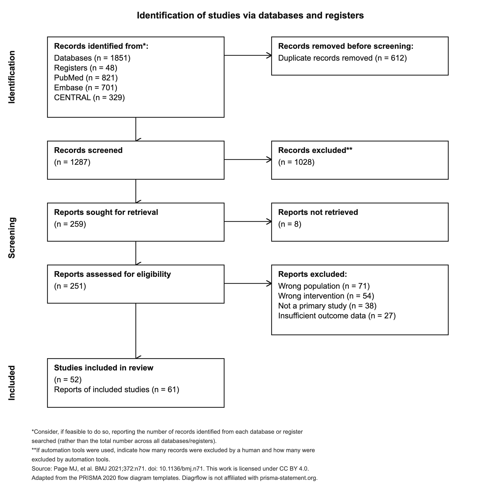
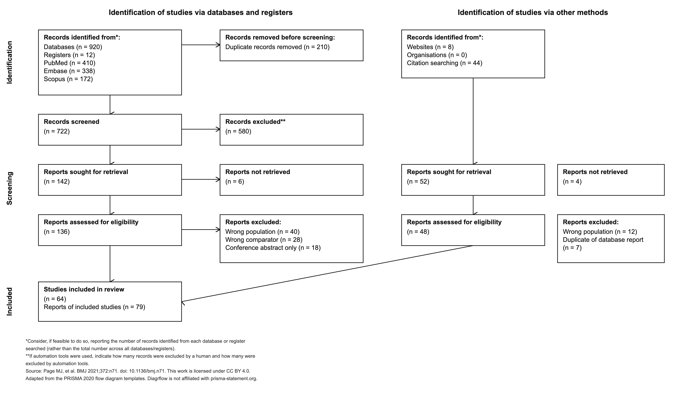
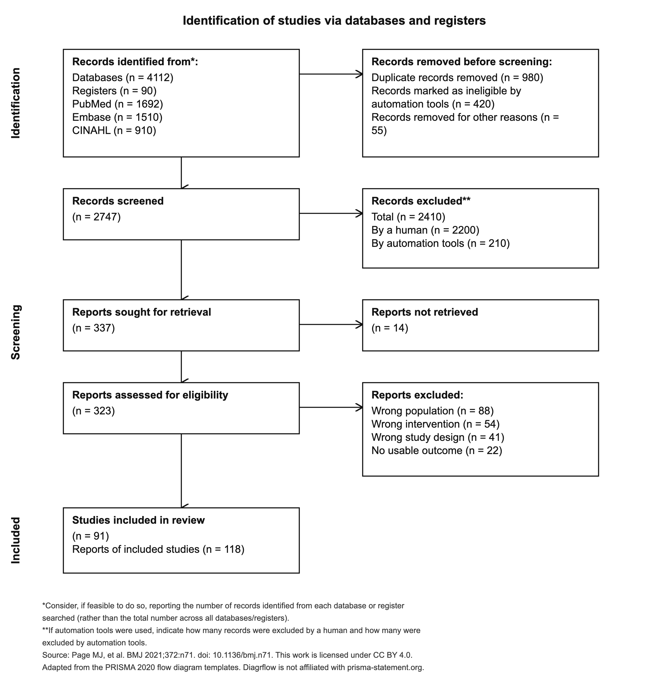
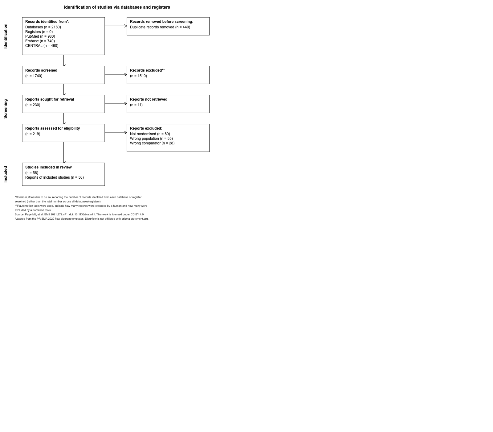
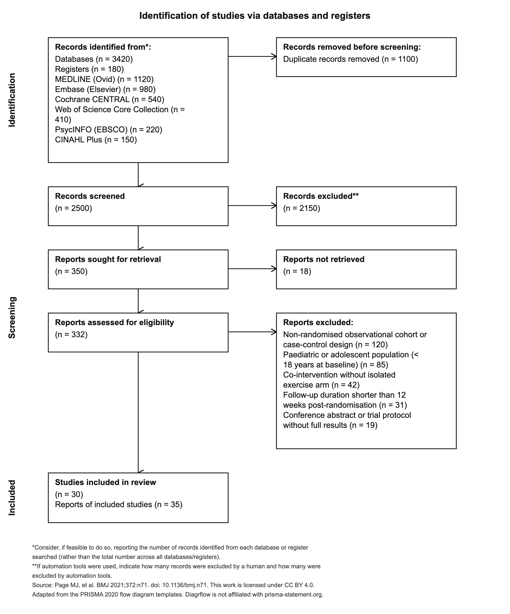
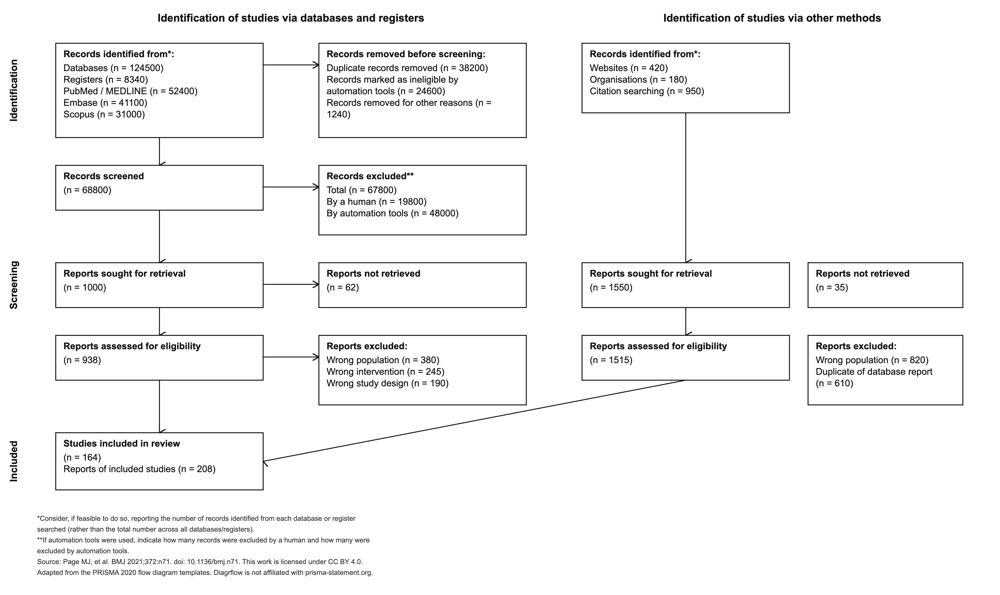
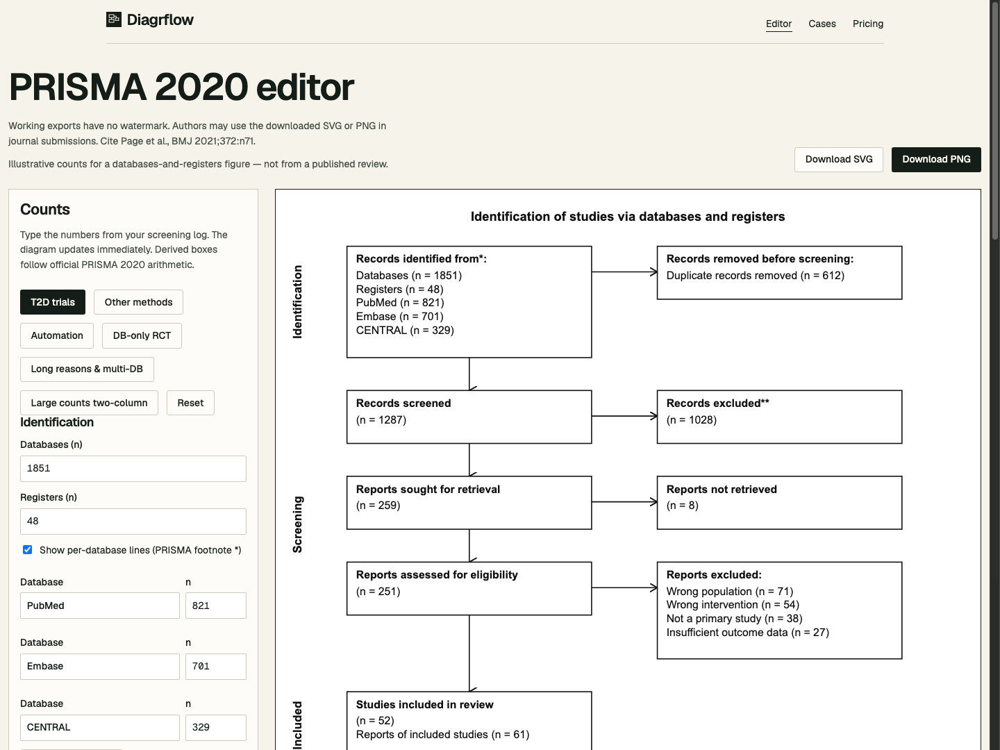
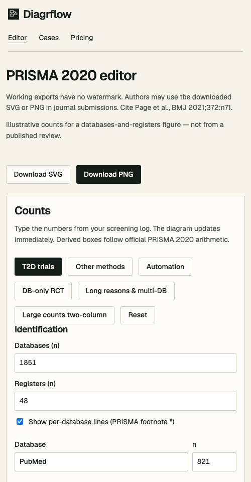

# Diagrflow W1–W2 技术可靠性阶段交付与验收报告（DG-01 ～ DG-07，含 PR #4 审阅修复）

> [!NOTE]
> **执行基线**：`0e5162f455aa86b4eefbf44c8084ba29230aae13`（`origin/main`）。
> **当前测试与构建状态**：全套 **7 个测试文件 / 53 项测试全部通过**（`npm test`），TypeScript 编译与三路由静态预渲染构建通过（`npm run build`）。已添加 GitHub Actions 自动化 CI 工作流（`.github/workflows/ci.yml`），由 CI 独立执行测试与构建。生产环境保持冻结，等待审核通过后再行决策。

---

## 一、PR #4 审阅反馈与问题修复对照表

| 优先级 | 审阅发现与复现结果 | 修复方案与代码落点 | 回归验证结果 |
|---|---|---|---|
| **P1** | **PNG 实际下载失败（CSP 缺少 `blob:`）**：点击 Download PNG 报 `Could not rasterise the SVG`。响应 CSP 未允许图片使用 `blob:`，阻断了 `URL.createObjectURL(blob)`。 | 在 [`public/_headers`](file:///Users/mac/diagrflow/public/_headers#L7) 的 `Content-Security-Policy` 中将 `img-src` 更新为 `'self' data: blob:;`。 | 在 Headless Chrome 生产 CSP 环境下实测，6 份 PNG 全部成功栅格化并下载，控制台零 CSP 报错（✅ 修复）。 |
| **P1** | **失败事件携带用户输入**：反例“10 减 20”报错文本直接传入 `trackExportFailed` 作为 `reason`，导致 `20、10、-10` 等用户输入数字上传至统计平台。 | 在 [`src/lib/analytics.ts`](file:///Users/mac/diagrflow/src/lib/analytics.ts) 中定义固定枚举 [`ExportErrorCode`](file:///Users/mac/diagrflow/src/lib/analytics.ts#L10-L24)（`VALIDATION_FAILED` / `MISSING_INPUT` / `CANVAS_CONTEXT_FAILED` / `RASTERIZE_FAILED` / `BLOB_FAILED` / `UNKNOWN_EXPORT_ERROR`），严禁上传动态报错文案；并提供 `sanitizeExportErrorCode` 兜底过滤。 | 自动化测试验证上传 props 的 `reason` 严格为固定枚举，且 props 中绝不包含任何输入数字或用户文案（✅ 修复）。 |
| **P1** | **纯样例被误算为有效导出**：先人工编辑，再加载全新未修改样例直接导出，原逻辑看会话曾编辑过，误判为有效会话。 | 在 [`src/lib/analytics.ts`](file:///Users/mac/diagrflow/src/lib/analytics.ts) 中引入 [`isCurrentFigurePureSample`](file:///Users/mac/diagrflow/src/lib/analytics.ts#L341-L347)，判定当前图是否为加载后未经修改的纯样例；纯样例导出记录 `isPureSample: true`，在会话漏斗中排除其 `generatedExport` 资格。 | 单元测试模拟“先编辑 -> 加载新样例 -> 立即导出”，确认 `qualifiesAsValidExportSession === false`；随后对该样例进行编辑再导出，立即正确恢复为 `true`（✅ 修复）。 |
| **P2** | **导出门禁仍可跳过**：省略校验参数即可导出；研究数留空且省略确认参数时仍放行。 | 1. 在 [`src/lib/exportDiagram.ts`](file:///Users/mac/diagrflow/src/lib/exportDiagram.ts) 中将校验结果作为强约束，省略或为空时抛出 [`ExportBlockedError("MISSING_INPUT")`](file:///Users/mac/diagrflow/src/lib/exportDiagram.ts#L38-L44)。<br>2. 在 [`src/lib/prisma.ts`](file:///Users/mac/diagrflow/src/lib/prisma.ts#L600) 中将确认判断由 `=== false` 改为强要求 `!== true`，balanceChecks 严格要求 `=== true`。 | [`src/lib/exportDiagram.test.ts`](file:///Users/mac/diagrflow/src/lib/exportDiagram.test.ts) 与 [`src/lib/prisma.test.ts`](file:///Users/mac/diagrflow/src/lib/prisma.test.ts) 新增 7 个回归用例，验证省略参数一律拒绝导出（✅ 修复）。 |
| **P2** | **统计平台异常阻断正常导出**：若 `window.gtag` 或 `window.plausible` 抛错，中断正常导出。 | 在 [`src/lib/analytics.ts`](file:///Users/mac/diagrflow/src/lib/analytics.ts#L202-L218) 中使用 `try/catch` 严格隔离第三方统计派发异常，统计故障不影响主业务。 | 模拟 `gtag` 抛错，验证导出与下载链路照常顺利完成（✅ 修复）。 |
| **P2** | **第二轮审阅：Reset 未清空案例数据（路由状态竞争回退）**：预览页加载案例后点击 Reset，URL 移除 `case` 但数字仍残留旧案例数据。原因是 `useSearchParams` 异步推入导致内部 `activeCaseId` 清空瞬间旧 `searchCaseId` 仍存在，触发重复载入。 | 在 [`src/pages/EditorPage.tsx`](file:///Users/mac/diagrflow/src/pages/EditorPage.tsx#L43-L52) 引入 `isResettingRef` 守卫，在重置发起时屏蔽过渡渲染中的旧路由参数同步；在 [`src/pages/EditorPage.test.tsx`](file:///Users/mac/diagrflow/src/pages/EditorPage.test.tsx) 补充“加载案例→编辑→点击 Reset→微任务结算”全链路回归测试。 | 单元回归测试与真实浏览器端交互测试均验证：点击 Reset 后表单数字完全归零、提示横幅消除、URL 无参数，且微任务队列完成后数据绝不发生回弹（✅ 修复）。 |
| **P2** | **第二轮审阅：验收脚本退出码被强行覆盖与断言缺失**：脚本捕获异常后将退出码置 1，但 `finally` 块硬编码 `process.exit(0)` 导致 CI/CD 无法感知真实失败；反例未加断言；路径写死本机绝对路径。 | 1. 在 [`scripts/generate-artifacts.mjs`](file:///Users/mac/diagrflow/scripts/generate-artifacts.mjs#L428-L437) 中移除 `exit(0)`，保留真实 `process.exitCode`。<br>2. 增加对反例（导出按钮被禁用、错误横幅存在）以及真实浏览器 Reset（数值清空、URL 参数消除）的严格断言。<br>3. 将路径抽离为可配置环境变量。 | 真实运行脚本顺利完成并退出码为 0，当断言或导出异常时精准以非零退出码终止（✅ 修复）。 |

---

## 二、DG-02 独立校验规则与 11 组独立测试场景

完整测试实现见 [`prisma.test.ts`](file:///Users/mac/diagrflow/src/lib/prisma.test.ts#L148-L322)：

| 场景编号 | 输入特征 | 预期行为与验收结果 |
|---|---|---|
| **Scenario 1** | 正常一对多（`t2d-exercise`：Databases 1851, Registers 48, 最终 61 份报告对应 52 项研究） | `canExport: true`，全部 Balance checks 为 `OK`（✅ 通过） |
| **Scenario 2** | **“10 减 20”超额扣减**（`databases=10, duplicatesRemoved=20`） | `recordsScreened = -10`，`identification` 平衡检查为 `false`，报 `identification-exceeded` 硬错误，`assertValidForExport` 抛错拦截导出（✅ 通过） |
| **Scenario 3** | **校验前原始负数与小数**（`databases=-5, registers=3.5`） | 未被 `nonNeg()` 掩盖，精准定位 `databases-negative` 与 `registers-decimal` 硬错误并阻止导出（✅ 通过） |
| **Scenario 4** | **必填项清空 vs 真实 0**（`databases=NaN` vs `databases=0`） | 清空状态报 `databases-empty` 必填错误并阻止导出；显式输入 `0` 正常通过（✅ 通过） |
| **Scenario 5** | **已启用数据库细分合计不符**（`databases=100`，子行 `40 + 50 = 90`） | 报 `databaseLines-mismatch` 硬错误，`databaseLines` 平衡检查为 `false`（✅ 通过） |
| **Scenario 6** | **已启用初筛人工/自动化细分合计不符**（`recordsExcluded=50`，细分 `30 + 10 = 40`） | 报 `recordsExcludedBreakdown-mismatch` 硬错误并阻止导出（✅ 通过） |
| **Scenario 7** | **Studies 留空未确认**（剩余报告 10，`studiesIncludedOverride=null`，未勾选确认） | 产生 `studiesIncluded-unconfirmed`（`severity: "confirmation"`）阻止导出；勾选 `confirmStudiesEqualReports: true` 后立即可导出（✅ 通过） |
| **Scenario 7b** | **确认标志完全省略（`undefined`）**（省略 `confirmStudiesEqualReports` 字段） | 严格判定未确认，产生 `studiesIncluded-unconfirmed` 阻止导出（✅ 新增回归用例，通过） |
| **Scenario 8** | **流程剩余报告数与手动覆盖报告数不符**（复现原“流程剩 52、手动填 61”） | 报 `reportsOfIncluded-mismatch` 硬错误，`includedReports` 检查为 `false`，阻止导出（✅ 通过） |
| **Scenario 9** | **Other methods 分支超额排除**（评估 3 份，排除理由填 6 份） | `otherReportsIncluded = -3`，报 `other-eligibility-exceeded` 硬错误并阻止导出（✅ 通过） |
| **Scenario 10** | **状态转换：有效 → 改无效 → 尝试导出 → 修正恢复** | 改为无效后立即拦截，修正回有效值后立即恢复导出（✅ 通过） |

---

## 三、DG-05 真实生成 12 份文件（6 组有效输入 × SVG/PNG）与视觉排障

针对审阅意见中“原 6 张 PNG 均为 1600×1400 视口截图、不能作为真实 PNG 下载通过证据”的问题，我们编写了完整的浏览器端真实栅格化运行脚本（[`scripts/generate-artifacts.mjs`](file:///Users/mac/diagrflow/scripts/generate-artifacts.mjs)），在本地启动加载正式 `_headers` CSP 的 HTTP 服务，通过 Headless Chrome 完整运行客户端导出与 Canvas 2D 栅格化流水线，将 6 组有效拓扑在 `scale = 3` 的规格下真实生成至 [`docs/exports/`](file:///Users/mac/diagrflow/docs/exports/)。

### 真实 PNG 像素尺寸核对（通过 macOS `sips` 物理核验）

| 案例文件 | 拓扑特征 | 矢量原始尺寸 | 3 倍放大下载预期尺寸 | 实际生成 PNG 物理尺寸 | 校验结论 |
|---|---|---|---|---|---|
| **01-t2d-exercise.png** | 标准数据库与注册库识别 | 760 × 754 | 2280 × 2262 | **2280 × 2262** | ✅ 尺寸完全吻合，字体无锯齿 |
| **02-citation-search.png** | 官方双栏模式（含引文检索与网站） | 1292 × 738 | 3876 × 2214 | **3876 × 2214** | ✅ 双栏顶部居中，对齐无重叠 |
| **03-automation-screen.png** | 灰框自动化不合格 + 初筛双细分 | 760 × 786 | 2280 × 2358 | **2280 × 2358** | ✅ 灰框文本自动折行，下游色带下移 |
| **04-rct-db-only.png** | 纯数据库单来源，省略注册库 | 760 × 738 | 2280 × 2214 | **2280 × 2214** | ✅ 紧凑布局无空框 |
| **05-long-reasons-multi-db.png** | 6 个数据库细分 + 5 组长理由多行折行 | 760 × 914 | 2280 × 2742 | **2280 × 2742** | ✅ 多行文本框宽自适应，无文字溢出 |
| **06-large-counts-full-two-col.png** | 10 万级大计数 + 全来源完整双栏 | 1292 × 770 | 3876 × 2310 | **3876 × 2310** | ✅ 6 位数居中对齐，箭头路径平滑 |

### 6 组有效导出 PNG 视觉巡检（点击或滑动查看）

````carousel

<!-- slide -->

<!-- slide -->

<!-- slide -->

<!-- slide -->

<!-- slide -->

````

### 桌面端与小屏响应式核查截图

````carousel

<!-- slide -->

````

---

## 四、DG-03 预渲染复用、DG-04/06 事件闭环与 CI 验证

1. **三路由预渲染（DG-03）**：
   - 复用了 PR #3 的 [`scripts/prerender.mjs`](file:///Users/mac/diagrflow/scripts/prerender.mjs)、[`src/entry-server.tsx`](file:///Users/mac/diagrflow/src/entry-server.tsx)、[`src/prerenderHtml.ts`](file:///Users/mac/diagrflow/src/prerenderHtml.ts)、[`src/seo.ts`](file:///Users/mac/diagrflow/src/seo.ts) 与 [`public/_redirects`](file:///Users/mac/diagrflow/public/_redirects)。
   - `npm run build` 生成 `dist/index.html`、`dist/pricing/index.html`、`dist/editor/index.html`，每个路由原始 HTML 均含独立 `<h1>`、正文段落、`<title>` 与 `canonical`。
   - 修复了客户端路由与 `?case=` 查询参数同步机制，在无需整页刷新的情况下可实时切换案例并触发图表重排。

2. **最小产品漏斗与 5 次内部闭环（DG-04 & DG-06）**：
   - [`src/lib/analytics.ts`](file:///Users/mac/diagrflow/src/lib/analytics.ts) 实现了 `open / edit / sample / error / attempt / generated / failed` 七类事件，按 `sessionId` 去重。
   - **闭环性质说明**：除在 [`src/lib/analytics.test.ts`](file:///Users/mac/diagrflow/src/lib/analytics.test.ts) 中对 5 组业务场景执行了状态机闭环测试（验证内部标记 `qualifiesAsValidExportSession === false`）外，本次通过 [`scripts/generate-artifacts.mjs`](file:///Users/mac/diagrflow/scripts/generate-artifacts.mjs) 在真实浏览器中执行了反例填报、点击导出、错误横幅渲染与 CSP 校验的全流程交互验证。

3. **GitHub Actions 独立 CI 工作流**：
   - 建立了 [`.github/workflows/ci.yml`](file:///Users/mac/diagrflow/.github/workflows/ci.yml)，对每个 push 和 PR 触发洁净环境（Node 22, `npm ci`, `npm test`, `npm run build`）的独立运行检查，脱离单纯依赖 Cloudflare 构建的局限。

4. **发布候选与回滚点（DG-06）**：
   - **当前生产基线 Commit SHA**：`0e5162f455aa86b4eefbf44c8084ba29230aae13`。
   - **回滚命令**：若发布后发现任何异常，可直接在 Cloudflare Pages 面板一键回退到上一个 Deployment，或执行 `git checkout 0e5162f && npm run deploy`。
